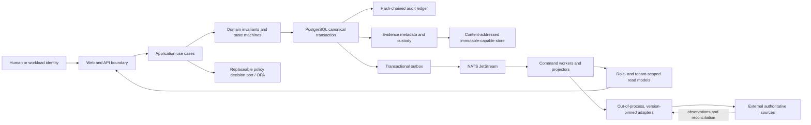

# TrustCircleAI

TrustCircleAI is a vendor-neutral AI governance control plane for continuous inventory,
human oversight, control orchestration, evidence custody, compliance mapping, remediation,
and governed integration across declared deployment boundaries.

This branch, `phase-18-tenancy-authority`, implements the platform-enhancement roadmap through
Spec 003 role-aware workspaces, discovery, Asset 360, responsive navigation, deployment identity,
and privacy-bounded analytics, plus the Spec 004 canonical workflows for review history, registers,
collaboration, evidence assurance, monitoring, governed change, AI lifecycle, connectors, entity
resolution, and multi-framework truth. These additions extend the existing authority, audit,
evidence, adapter, and projection seams; they do not create a second source of truth. See the
[implementation status](roadmap/trustcircle-platform-enhancement-implementation-status.md),
[Spec 003](specs/003-platform-enhancement-workspaces/spec.md), and
[Spec 004](specs/004-governed-platform-continuation/spec.md).

> **Architectural invariant:** a convenient UI, event, search result, dashboard, or telemetry signal
> never becomes governance authority. Consequential state changes require current human authority,
> policy and separation-of-duties checks, an atomic canonical state and audit commit, and retained
> evidence.

## See it running


A 47-second tour of the operator console on a fresh `scripts/provision.sh --target compose`
instance, in read-only local preview. Full-quality video:
[docs/media/trustcircle-ui-tour.mp4](docs/media/trustcircle-ui-tour.mp4).

## ISO/IEC 42001 alignment

TrustCircleAI is designed to support ISO/IEC 42001 AI management system implementation and audit
readiness. Its controls and evidence are mapped to the standard's clauses 4–10 and Annex A control
areas, and it ships a sample, non-certified ISO/IEC 42001 / 42005 / 42006 readiness package
(`tests/fixtures/audit-readiness/`). It reports readiness, never certification: only an accredited
certification body can certify an organisation. See
[docs/compliance/ISO42001.md](docs/compliance/ISO42001.md).

## Provisioning an instance

Consumers stand up their own control plane with one idempotent script, on Docker Compose or
Kubernetes:

```bash
scripts/provision.sh --target compose                       # single host, http://localhost:14000
scripts/provision.sh --target kubernetes --registry <registry> --push
```

Secrets are generated per instance and never committed, and every run writes a provisioning receipt
as change evidence. See [docs/PROVISIONING.md](docs/PROVISIONING.md). Claude Code users can ask the
`provisioner` agent (`.claude/agents/provisioner.md`) to do it interactively.

## Architecture at a glance



The monorepo keeps the transactional governance core separate from independently deployable APIs,
workers, projectors, discovery, web presentation, and adapters. Domain code remains independent of
transport, database, policy-engine, object-store, and vendor libraries so those technologies remain
replaceable behind explicit ports and contracts.

## Authority and responsibility boundaries

| Boundary                                                          | Authoritative for                                                                                     | Never authoritative for                                                                    |
| ----------------------------------------------------------------- | ----------------------------------------------------------------------------------------------------- | ------------------------------------------------------------------------------------------ |
| PostgreSQL canonical state and committed audit events             | Governance decisions, permissions, mappings, operation state, evidence metadata, and durable versions | External source fields not owned by TrustCircleAI                                          |
| External source through an approved contract                      | Only the fields declared in its active `SourceContractVersion` and adapter manifest                   | TrustCircleAI authorization, verified closure, or compliance claims                        |
| Policy decision point                                             | A version-bound decision for supplied facts                                                           | Expanding identity, tenant scope, delegation, or fixed separation-of-duties guardrails     |
| Evidence object store                                             | Preserved original and derived content by digest                                                      | Business-row state, access authority, or retention decisions                               |
| NATS, SSE, projections, search, dashboards, Kanban, and telemetry | Transport and rebuildable presentation                                                                | Authorizing commands, proving closure, or replacing canonical state                        |
| Platform workspaces and copilot                                   | Authorized, citation-bound presentation and safe navigation                                           | Mutation, independent assurance, legal advice, conformity, accreditation, or certification |

### Important architectural points

1. **Humans retain consequential authority.** Automation may recommend, simulate, prepare, or execute
   only inside an approved, versioned, time-bounded policy. Self-approval is prohibited where roles
   conflict, delegation cannot expand authority, and platform administration alone grants no governance
   data access.
2. **Tenant planning precedes every read and write.** The authenticated assignment, role set, resource
   scope, environment, action, and validity window are evaluated server-side. `X-Tenant-ID`, a route,
   hidden UI control, local cache, or client-side filter is never authority. Production persistence uses
   tenant context and forced row-level security.
3. **Canonical change and audit commit together.** State transition, policy-decision reference, audit
   event, and outbox message are one transaction. If the audit record is missing, the action failed.
4. **Remote uncertainty remains uncertainty.** A timeout or lost acknowledgement after dispatch becomes
   `pending_reconciliation`; it is not reported as success and is not blindly retried as a new effect.
5. **Original evidence is preserved.** Repair, normalization, redaction, and export create attributable
   derivatives linked by provenance. They never silently overwrite malformed, partial, or original
   material.
6. **Unknown and degraded are first-class states.** Unavailable, stale, partial, unauthorized,
   verified-empty, blocked, and unknown states stay distinct. Missing coverage cannot be converted to
   healthy, absent, compliant, or complete.
7. **Adapters are replaceable and least-privileged.** Vendor behavior and credentials stay outside the
   core. Adapters use versioned contracts, capability allowlists, idempotency, bounded retries,
   reconciliation, evidence capture, and source-native APIs—never direct foreign database access.
8. **Contracts evolve compatibly.** Same-major changes are additive. Breaking meaning, authority,
   ordering, security, or failure semantics requires a new major, consumer evidence, a deprecation
   window, migration, and rollback plan.
9. **Compliance language is deliberately narrow.** A mapping, dashboard posture, readiness assessment,
   or internal control result does not establish legal compliance or external certification.
10. **Deployment identity is not assurance.** A build version, environment profile, healthy process, or
    completed test is useful evidence, but only the governed release gate determines whether the covered
    release is approved. Deferred or indeterminate evidence blocks release and must never be relabeled.

11. **Signed review history is immutable governance truth.** A snapshot binds exact source,
    schema, registry, policy, signer, and signature versions. Corrections link to signed history;
    comparisons are reproducible only across compatible periods and preserve unknown outcomes.
12. **Registers, views, and collaboration preserve current authority.** Risk, gap, exception, and
    improvement transitions are optimistic and separation-of-duties constrained. Shared views store
    an allowlisted query AST, not authorized results, and every notification is minimized and
    reauthorized when rendered for delivery.
13. **Monitoring preserves observations and previews are pure.** Deduplication creates one actionable
    case without deleting source facts. Stale, partial, conflicting, or unhealthy signals never infer
    pass. Change impact is version-pinned and non-mutating; drift invalidates approval before
    publication, rebuild, or rollback.
14. **AI governance binds the exact component set.** Use-case activation depends on current
    independently reviewed model, provider, prompt, tool, data, evaluation, and monitoring versions.
    Copilot retrieval is authorized before invocation, cites exact governed records, labels fact versus
    inference or suggestion, abstains when support is insufficient, and cannot call approval actions.
15. **Connector certification is exact and revocable.** Guided authoring produces the canonical
    manifest; signed conformance evidence covers success and all required failure dimensions. A
    separate certifier binds the exact digest, tenant, scope, capability, credential class, validity,
    compatibility, and health bounds. Revocation blocks new work but retains uncertain work for
    reconciliation.
16. **Entity and framework truth are never flattened.** Entity resolution preserves source identities
    and reversible review history. Framework projections retain mapping ambiguity and keep
    applicability, organizational duty, control coverage, evidence sufficiency, readiness, assessment,
    and external certification as separate facts.

## Command and query behavior

### Governed command path

1. Authenticate the principal and resolve current tenant-scoped assignments, attributes, delegation,
   break-glass state, and separation-of-duties constraints.
2. Validate the versioned request contract, scope, reason, idempotency key, correlation ID, expected
   resource version, and source preconditions.
3. Evaluate the active signed policy bundle and non-waivable authority guardrails.
4. Atomically commit the requested state transition, policy-decision reference, audit event, and outbox
   message.
5. A worker revalidates time-sensitive authority and preconditions before using a version-pinned adapter.
6. Confirm the remote outcome with evidence, or retain a rejected, failed, or
   `pending_reconciliation` state until observation resolves it.

Mutations use `Idempotency-Key`, `X-Correlation-ID`, and `If-Match` where an aggregate already exists.
Reusing a key with the same digest returns the prior result; reusing it for a different request is a
conflict.

### Query and workspace path

Projectors consume committed events through durable inboxes and build reconstructable read models with
canonical version, source cursor, generated time, freshness, provenance, and partial-coverage metadata.
The web layer establishes the permitted `DomainPlan` before loading domains and then exposes only
allowlisted presentation fields.

Saved views contain filter metadata only and are scoped to the current tenant and role-set witness.
Product analytics accepts only `application/json` bodies of at most 2048 actual UTF-8 bytes containing
bounded route, outcome, duration-bucket, result-count, and binary-feedback events; queries, record
identifiers, evidence, governed content, arbitrary routes, wrong media types, oversized bodies, and
unknown fields are rejected before logging.

## Architecture governance

### Source-of-truth order

When artifacts disagree, resolve the conflict in this order and block the affected release until they
are synchronized:

1. The [TrustCircleAI Constitution](.specify/memory/constitution.md) defines non-negotiable principles
   and supersedes local conventions.
2. Approved feature specifications, data models, and versioned contracts define intended behavior and
   boundary semantics.
3. Plans and tasks define the approved delivery approach and implementation sequence.
4. Code, migrations, tests, traceability, and retained evidence demonstrate what is implemented.
5. The roadmap defines prioritization and continuation; it cannot grant authority or waive a gate.

An implementation discrepancy is not resolved by silently changing a claim. Update the governing
artifact through review, or change the implementation and evidence to satisfy it.

### Required change workflow

Every material architecture change must:

1. Identify inventory and deployment boundaries, affected tenants, authoritative data, consequential
   actions, human owners, failure behavior, compatibility, rollback, evidence, and observability.
2. Update the related `spec.md` and run the pre-design Constitution Check.
3. Record design decisions in `plan.md`, `research.md`, `data-model.md`, and versioned contracts as
   applicable; repeat the Constitution Check after design.
4. Generate or update dependency-ordered `tasks.md`, including negative-path, boundary, migration,
   resilience, accessibility, and evidence work.
5. Implement behind domain/application ports. Keep vendor and transport details at adapter or
   infrastructure boundaries.
6. Update traceability and implementation evidence with genuine command outputs and durable witnesses.
7. Synchronize related specs and integration notes. Update `.specify` templates or constitution memory
   when the change alters project-wide governance—not for a feature-local exception.
8. Obtain independent review where authority, tenant isolation, evidence/audit integrity, compliance
   claims, destructive remediation, or external contracts are affected.

### Review triggers and mandatory evidence

| Change area                               | Mandatory architectural proof before release                                                                                                     |
| ----------------------------------------- | ------------------------------------------------------------------------------------------------------------------------------------------------ |
| Consequential action or delegation        | Explicit human owner, SoD matrix, self-approval denial, reason and expiry rules, policy-version binding, accepted and rejected audit evidence    |
| Tenant, identity, or access boundary      | Cross-tenant negative tests, server-side role filtering, row-level policy evidence, workload identity and break-glass behavior                   |
| Audit or evidence custody                 | Atomicity, hash/provenance verification, access and retention behavior, legal-hold/disposition checks, failure-path preservation                 |
| Adapter or remote mutation                | Signed manifest, contract/conformance tests, least privilege, idempotency, timeout/lost-ack reconciliation, bounded retry and rollback behavior  |
| Public contract or event                  | Semantic-version impact, generated-contract check, consumer compatibility, ordering/unknown-field behavior, migration and rollback               |
| Read model, search, analytics, or copilot | Authorization-before-load, disclosure allowlist, freshness/partial coverage, tenant isolation, privacy negatives, citation and no-mutation proof |
| Compliance or assurance claim             | Exact scope, applicability and owner, evidence sufficiency, independent review, and wording that distinguishes readiness from certification      |
| Release or deployment topology            | Approved artifact identity, configuration/schema compatibility, health plus governance gates, rollback rehearsal, retained release evidence      |

> **Release rule:** required approval, ownership, tests, evidence, monitoring, rollback,
> reconciliation, migration, or standards mapping that is missing, stale, failing, deferred, or
> indeterminate blocks the affected release.

## Repository boundaries

```text
apps/
  api/                  versioned command/query APIs and runtime composition
  web/                  accessible, server-rendered governance workspaces
  command-worker/       governed operation execution
  projector/            role-specific rebuildable read models
  discovery-agent/      least-privilege source discovery
packages/
  domain/               entities, invariants, ranking, and state machines
  application/          use cases and infrastructure ports
  authz/ policy/        tenant authority, RBAC/ABAC/SoD, policy lifecycle and PDP port
  persistence/          PostgreSQL repositories, outbox/inbox, and migrations
  audit-ledger/         hash chain, checkpoints, and verification
  evidence/             content-store port, provenance, retention, and export
  projections/          operational, executive, compliance, and auditor read models
  contracts/            generated OpenAPI, AsyncAPI, and JSON Schema bindings
  adapter-sdk/          adapter protocol, conformance kit, and compatibility harness
  observability/        health, metrics, traces, and disclosure-safe telemetry
adapters/
  agentctl/ kanban/ lisa/ wiggum/ workflow-orchestration/
db/migrations/          additive and reversible canonical schema evolution
deploy/                 Compose and Kubernetes deployment profiles
specs/                  feature authority, plans, contracts, tasks, and traceability
.specify/               project-wide constitution, templates, and specification workflows
roadmap/                 prioritized platform evolution and honest implementation status
```

## Verification

Use Node.js 22 and npm 10. Install the locked workspace dependencies, then run focused checks while
developing and the governed PR/release gates before claiming completion.

```bash
npm ci
npm run contracts:validate
npm run contracts:check
npm run typecheck
npm run lint
npm run format
npm run test:unit
npm run test:contract
npm run test:integration
npm run test:security
npm run verify:pr
npm run verify:release
```

Release and assurance checks are separate from ordinary build success:

```bash
npm run evidence:verify
npm run test:audit-readiness
npm run verify:release:gate
```

The command result and covered evidence determine the outcome. Do not reinterpret a held or
indeterminate gate as passing.

## Authoritative documentation

- [Project constitution](.specify/memory/constitution.md)
- [Governance control-plane plan](specs/001-governance-control-plane/plan.md)
- [Canonical data model](specs/001-governance-control-plane/data-model.md)
- [Interface contract rules](specs/001-governance-control-plane/contracts/README.md)
- [Operations Command Center plan](specs/002-operations-command-center/plan.md)
- [Platform Enhancement Workspaces plan](specs/003-platform-enhancement-workspaces/plan.md)
- [Platform enhancement traceability](specs/003-platform-enhancement-workspaces/traceability.md)
- [Governed Platform Continuation plan](specs/004-governed-platform-continuation/plan.md)
- [Governed Platform Continuation contracts](specs/004-governed-platform-continuation/contracts/)
- [Governed Platform Continuation traceability](specs/004-governed-platform-continuation/traceability.md)
- [Governed Platform Continuation implementation audit](specs/004-governed-platform-continuation/implementation-audit.md)
- [Enhancement roadmap](roadmap/trustcircle-platform-enhancement-roadmap.md)
- [Current enhancement implementation status](roadmap/trustcircle-platform-enhancement-implementation-status.md)
