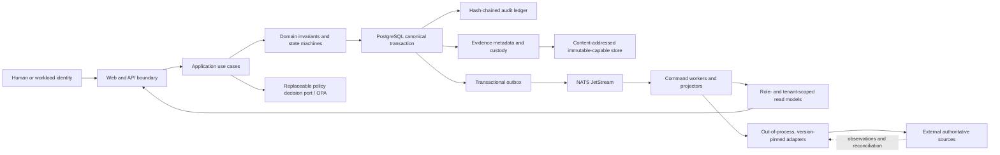

# TrustCircleAI

TrustCircleAI is an open-source AI governance control plane. It keeps a continuously reconciled
inventory of the AI your organisation runs, routes consequential decisions to the people who hold
the authority to make them, watches controls and evidence, and produces audit evidence an external
assessor can verify. It is vendor-neutral and self-hosted.

> **Architectural invariant:** a convenient UI, event, search result, dashboard, or telemetry signal
> never becomes governance authority. Consequential state changes require current human authority,
> policy and separation-of-duties checks, an atomic canonical state and audit commit, and retained
> evidence.

## See it running


A 55-second tour in two captioned parts:

1. **Live local instance** from `scripts/provision.sh --target compose`, in its read-only auditor
   preview: dashboard, the `/` search shortcut, operations, the decision inbox, compliance and
   trends.
2. **Decision screens** on the same production web build, with sample data from a stub API and
   signed in as an approver: the inbox, a full decision package, an approval with a reason, and
   the separation-of-duties explanation on the approver's own request. The local preview cannot
   hold decisions until an identity gateway is configured, which is why this part uses sample
   data.

Full-quality video: [docs/media/trustcircle-ui-tour.mp4](docs/media/trustcircle-ui-tour.mp4).

## What you get

- **AI inventory you can trust.** A continuously reconciled register of AI assets inside the boundary
  you declare, with owners, risk, lifecycle stage, controls, evidence and freshness. Unknown,
  unowned or unreachable items stay visible as gaps.
- **Human decisions with real authority.** Decision packages (scope, impact, risks, alternatives,
  approval gates, evidence) go to people who hold the authority. Every action needs a reason, is
  bound to the version reviewed, and self-approval is refused.
- **Operations queue and owned cases.** One explainable priority order across domains; each real
  control failure becomes one owned case with service levels and escalation.
- **Integrity protection.** Damaged or suspicious incoming governance work is quarantined before it
  can trigger anything, with bounded, attributable repair.
- **Evidence custody.** Originals are preserved; derivatives are linked by provenance; evidence is
  requested, attested, judged for sufficiency and packaged with signatures.\*
- **Tamper-evident audit.** A hash-chained audit ledger with signed checkpoints and independent
  verification.
- **Multi-framework readiness.** ISO/IEC 42001, the EU AI Act, NIST AI RMF and internal policy held
  once and mapped to controls, reported as readiness and never as certification.
- **Signed review periods.** Each review is signed and can be compared with the previous one.\*
- **Role-aware console.** Workspaces for governance officers, approvers, control owners and
  auditors, in light and dark themes, checked with automated axe scans against WCAG 2.2 AA for
  every role and theme.

\* Implemented in the application layer and not yet wired into the production runtime; see
[Current limitations](#current-limitations).

## Who it is for

- **Governance and risk leads** who need one truthful answer to "what AI do we run, who owns it,
  and is it under control".
- **Approvers** who need the full context before deciding, and a record of why they decided.
- **Control owners and operators** who need failures owned and closed, not rediscovered at audit.
- **Auditors and assessors** who need evidence they can verify without taking anyone's word for it.
- **Platform teams** who need to run it themselves, on Docker Compose or Kubernetes.

The business case and adoption metrics are in [docs/BUSINESS_ADOPTION.md](docs/BUSINESS_ADOPTION.md).

## Quick start

Requirements: Docker Engine 24+ with Compose v2, about 8 GiB of RAM, and ports 14000 and 14001 free.

```bash
git clone https://github.com/mairp/trustcircle.git && cd trustcircle
scripts/provision.sh --target compose
curl -fsS http://localhost:14001/v1/readiness    # API readiness; console at http://localhost:14000
```

The script generates per-instance secrets (never committed), brings the ten core components up in
order, waits until each is healthy, and writes a provisioning receipt to `.provision/` that you can
keep as change evidence.

For Kubernetes:

```bash
scripts/provision.sh --target kubernetes --registry <your-registry> --push
```

Add `--dry-run` to either command to see what would happen first. Everything else, including
secrets, identity and troubleshooting, is in [docs/PROVISIONING.md](docs/PROVISIONING.md).
Claude Code users can ask the `provisioner` agent (`.claude/agents/provisioner.md`) to walk
through it.

## How it keeps you safe

- **People keep consequential authority.** Automation recommends, prepares and executes only inside
  an approved, versioned, time-bounded policy. It never approves, closes or certifies.
- **Separation of duties is enforced, not advised.** Self-approval is refused, delegation cannot
  expand authority, and platform administration alone grants no access to governance data.
- **Tenant scope is checked on the server, every time,** backed by PostgreSQL row-level security.
- **State and audit commit together.** If the audit record is missing, the action did not happen.
- **Uncertainty stays uncertainty.** A timeout after dispatch is `pending_reconciliation`, never
  reported as success.
- **Originals are never overwritten.** Repair, redaction and export create linked derivatives.
- **Unknown is not healthy.** Unavailable, stale, partial and unknown states stay distinct; missing
  coverage is never shown as compliant or complete.
- **Integrations are least-privileged and replaceable.** Vendor credentials stay outside the core;
  adapters use versioned contracts, idempotency and reconciliation.

The full set of principles is in the [architecture overview](docs/architecture/overview.md).

## ISO/IEC 42001 alignment

TrustCircleAI is designed to support ISO/IEC 42001 AI management system implementation and audit
readiness. Its controls and evidence are mapped to the standard's clauses 4–10 and Annex A control
areas, and it ships a sample, non-certified ISO/IEC 42001 / 42005 / 42006 readiness package
(`tests/fixtures/audit-readiness/`). It reports readiness, never certification: only an accredited
certification body can certify an organisation. See
[docs/compliance/ISO42001.md](docs/compliance/ISO42001.md).

## Architecture



A transactional governance core (PostgreSQL, hash-chained audit, transactional outbox) sits behind
independently deployable APIs, workers, projectors, discovery and the web console. Policy (OPA),
messaging (NATS JetStream) and evidence storage (S3-compatible) are replaceable behind explicit
ports. Details: [docs/architecture/overview.md](docs/architecture/overview.md).

## Current limitations

Stated plainly, so you can plan around them:

- **Identity.** A fresh install runs a read-only auditor preview. Decisions, approvals and
  separation of duties need real identities through an OIDC gateway in front of the console and API
  (see [docs/PROVISIONING.md](docs/PROVISIONING.md#identity-and-access)).
- **Governed workflow services.** Registers and shared views, evidence requests and signed
  packages, signed review periods, continuous control monitoring, the AI use-case lifecycle and
  connector certification are implemented and tested in the application layer, but the production
  runtime does not wire their persistence yet; the console shows those panels as unavailable.
  Listing and downloading evidence packages also still need API endpoints.
- **Connectors.** The shipped adapters are reference adapters for internal work-tracking and
  agent-orchestration tools. Corporate systems (issue tracker, ITSM, model registry, chat) need a
  connector built and certified through the platform's conformance process.
- **Copilot.** The copilot is deterministic and citation-bound today; a language model behind it is
  on the roadmap and would itself be governed by the platform.

Every accepted gap, with its owner and review date, is in
[docs/governance/known-gaps.md](docs/governance/known-gaps.md).

## Documentation

| Adopt                                                          | Operate                                                     | Assure                                                                 | Build                                                             |
| -------------------------------------------------------------- | ----------------------------------------------------------- | ---------------------------------------------------------------------- | ----------------------------------------------------------------- |
| [Business adoption](docs/BUSINESS_ADOPTION.md)                 | [Provisioning](docs/PROVISIONING.md)                        | [ISO/IEC 42001 alignment](docs/compliance/ISO42001.md)                 | [Architecture overview](docs/architecture/overview.md)            |
| [Deployment options](docs/deployment/options.md)               | [Operations runbook](docs/runbooks/operations.md)           | [Threat model](docs/security/threat-model.md)                          | [Contributing](CONTRIBUTING.md)                                   |
| [Known gaps](docs/governance/known-gaps.md)                    | [Human decisions runbook](docs/runbooks/human-decisions.md) | [Compliance assurance runbook](docs/runbooks/compliance-assurance.md)  | [API and event contracts](contracts/)                             |
| [Roadmap](roadmap/trustcircle-platform-enhancement-roadmap.md) | [Disaster recovery](deploy/kubernetes/recovery/runbook.md)  | [Repository sanitisation report](docs/security/SANITIZATION_REPORT.md) | [Compatibility policy](docs/architecture/compatibility-policy.md) |

## Contributing

Contributions are welcome. Because the platform governs consequential decisions, every change must
keep authority, tenant isolation, audit and evidence integrity intact and pass the full verification
gate. Start with [CONTRIBUTING.md](CONTRIBUTING.md).

## License

Licensed under the [Apache License, Version 2.0](LICENSE).
